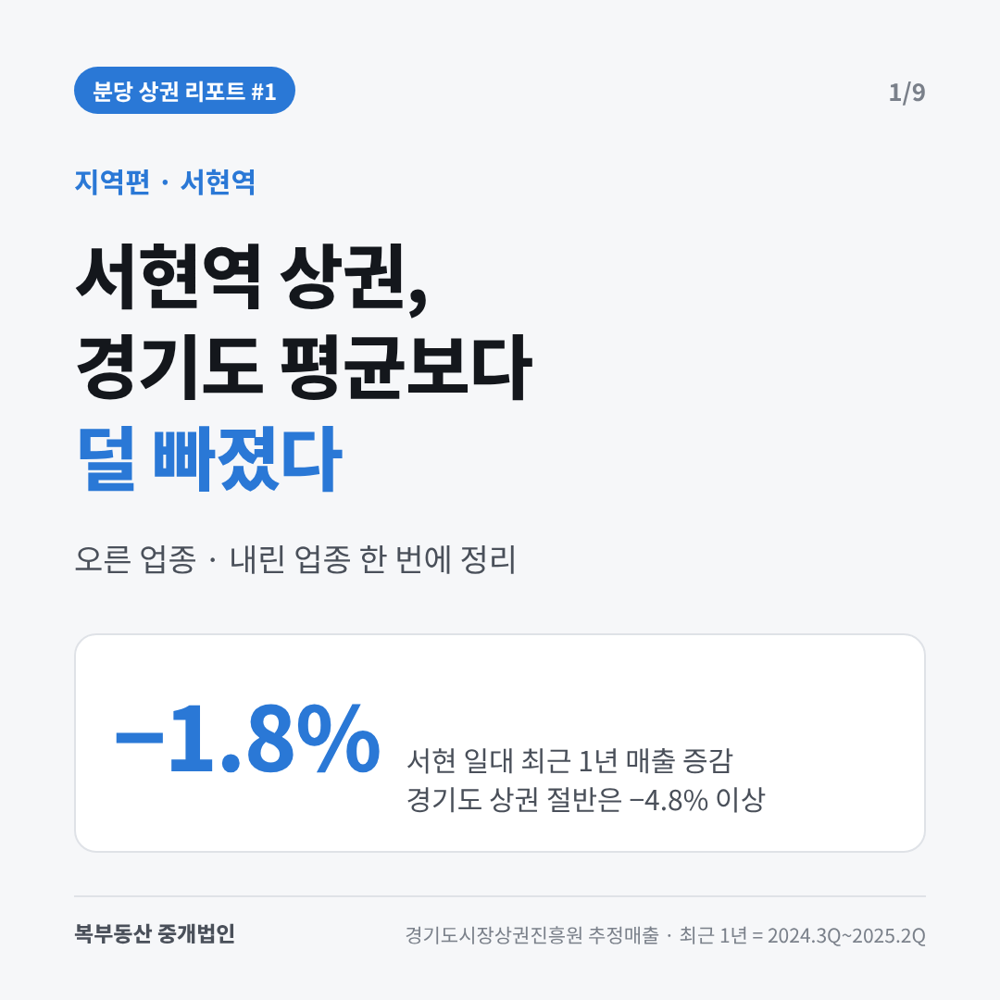
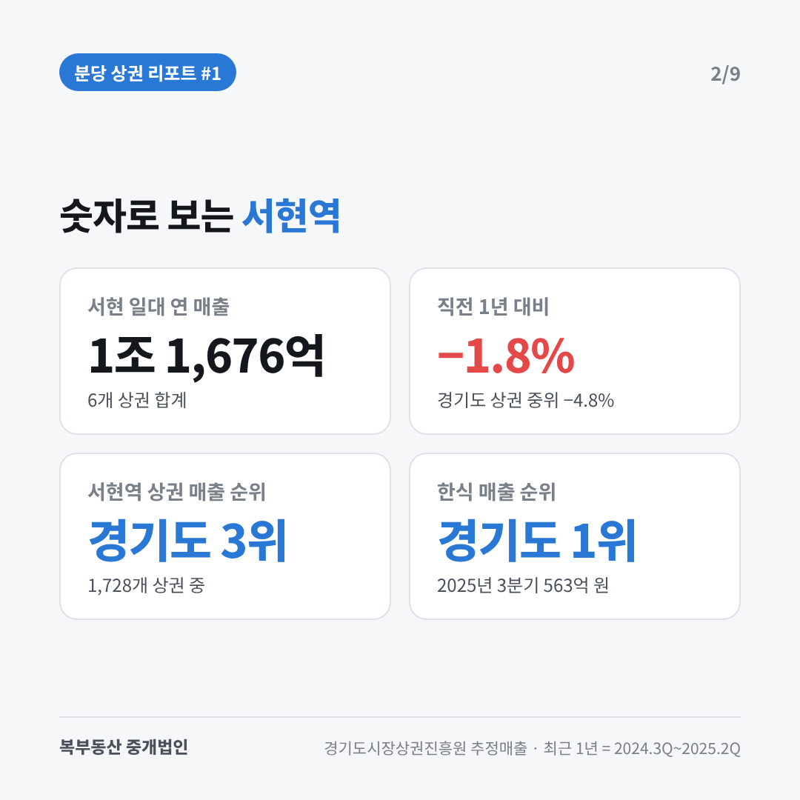
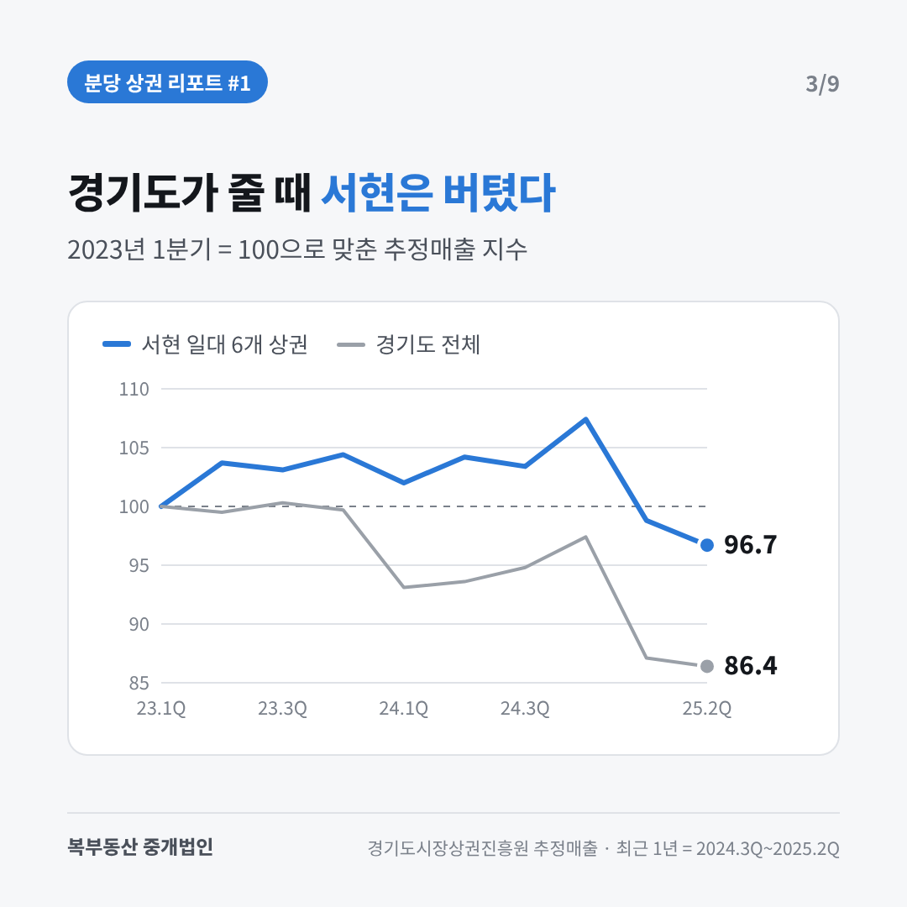
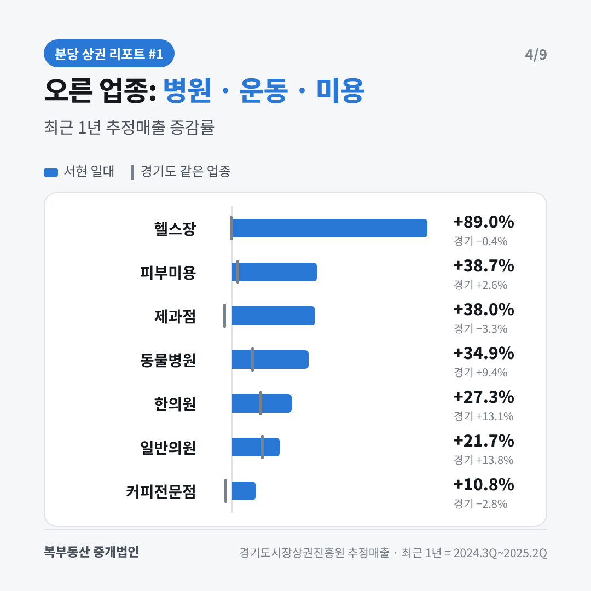
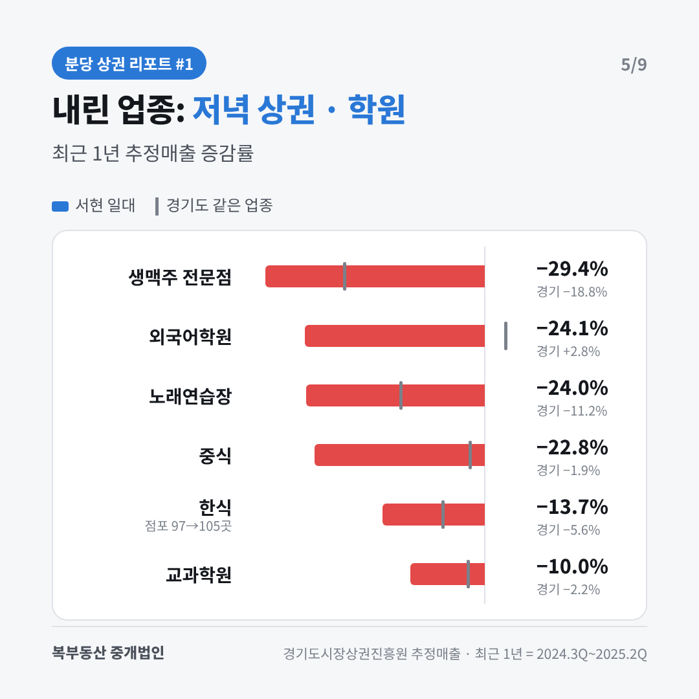
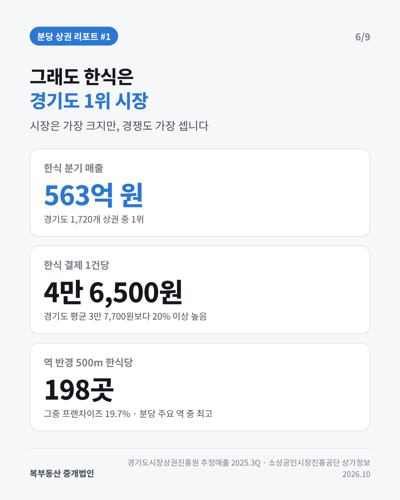
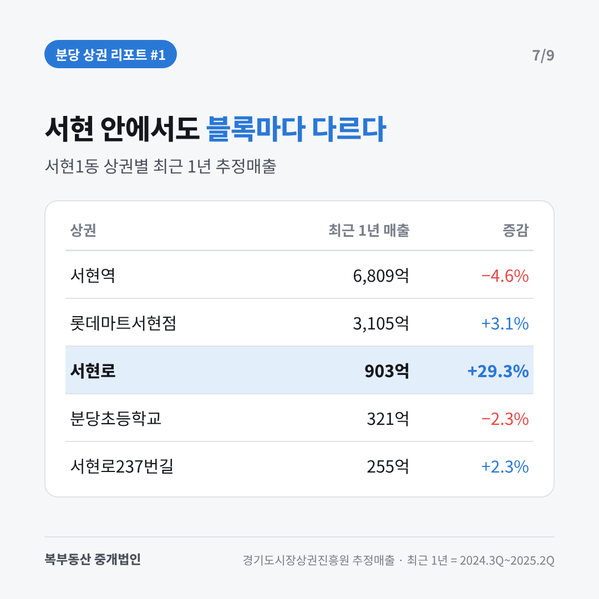
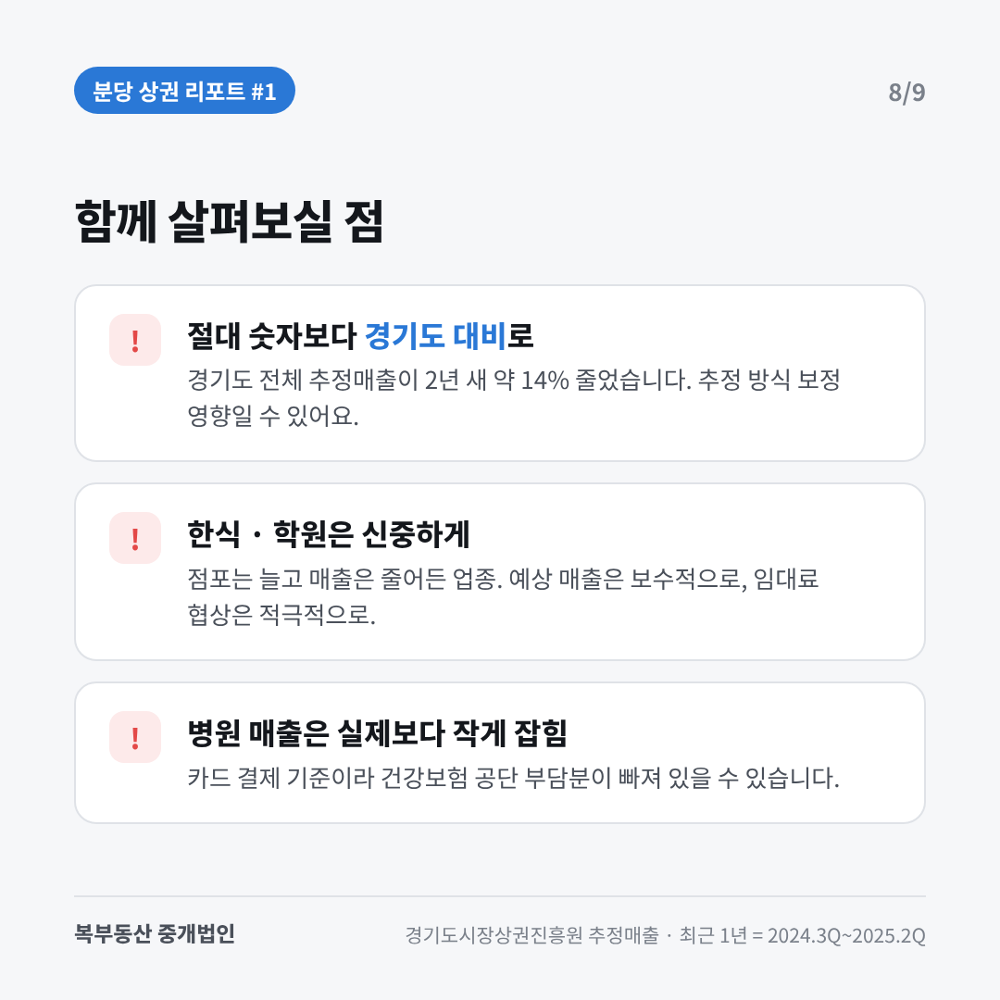

# [상권 리포트 #1] 서현역 — 블로그 초안

> 트랙: 🗺️ 지역편 / 카테고리: 📊 상권 리포트 > 지역편
> 원본: [서현역 상권 추정매출](https://claude.ai/artifact/Rs7b8sRjys9hU8B6yDDj5v) + [분당 프랜차이즈 한식당 리포트](https://claude.ai/artifact/XcYftpigtCCif5r4sFVHaA)의 서현역 수치
> 메인 키워드: **서현역 상권** / 보조: 서현역 상권분석, 서현동 상가, 분당 창업 업종
> 상태: 숫자는 리포트 수치로 채움. `【현장】` 칸과 현장 사진만 채우면 발행 가능.
> 카드 만들기: `node tools/card_maker/make_cards.mjs 04_글감/상권리포트_01_서현역` → `발행본.md`
> `{{card:카드이름}}` = 자동 생성 카드 자리 (`cards.json`) / 📷 = 직접 찍을 현장 사진

---

## 제목 (하나 선택)

1. `[상권 리포트 #1] 서현역 상권, 경기도 평균보다 덜 빠졌다 | 오른 업종·내린 업종 정리`
2. `[상권 리포트 #1] 서현역 상권분석 | 병원·헬스장은 오르고 한식·학원은 내렸다`

---

## 본문

안녕하세요, 분당에서 상가·사무실을 중개하는 한지훈입니다.

손님들께 "서현역 요즘 어때요?"라는 질문을 정말 많이 받습니다.
그래서 감이 아니라 **숫자로** 답해드리려고, 경기도가 공개한 상권 매출 자료를 직접 정리해봤습니다.
오늘부터 이렇게 만든 상권 리포트를 한 편씩 공유하려고 합니다. 첫 번째는 분당의 대표 상권, **서현역**입니다.

📷 서현역 출구 / AK플라자 앞 현장 사진

---

### 📊 한눈에 보기

> - 서현역 일대 6개 상권 최근 1년 추정매출 **1조 1,676억 원**
> - 직전 1년 대비 **−1.8%** (경기도 상권 절반이 −4.8% 넘게 줄어든 기간)
> - '서현역' 상권 매출 규모 **경기도 1,728개 상권 중 3위**
> - 한식 매출은 **경기도 1위** (2025년 3분기 563억 원)
>
> 기준: 최근 1년 = 2024년 3분기~2025년 2분기, 직전 1년과 비교

---

### 1. 경기도 전체가 줄 때, 서현은 덜 줄었습니다

2023년 1분기를 100으로 놓고 보면, 2025년 2분기에 경기도 전체는 **86.4**까지 내려갔지만 서현 일대는 **96.7**에 머물렀습니다.
2024년 말까지는 오히려 버티다가 2025년 들어 같이 내려온 모습입니다.

"서현은 예전만 못하다"는 이야기가 많지만, 숫자로 보면 **경기도 다른 상권보다는 잘 버틴 편**입니다.

---

### 2. 오른 업종 ① 병원·한의원·동물병원

| 업종 | 최근 1년 매출 | 증감 | 경기도 같은 업종 |
|---|---|---|---|
| 일반의원 | 1,556억 원 | **+21.7%** | +13.8% |
| 한의원 | 313억 원 | **+27.3%** | +13.1% |
| 동물병원(수의업) | 298억 원 | **+34.9%** | +9.4% |

일반의원은 점포가 77곳에서 89곳으로 늘었는데도, 매출이 그보다 더 크게 늘었습니다.
서현역 대로변 빌딩의 2층 이상 메디컬 공간 수요가 꾸준한 이유입니다.

---

### 3. 오른 업종 ② 미용·운동·베이커리·카페

| 업종 | 증감 | 점포 수 변화 |
|---|---|---|
| 체력단련시설(헬스장) | **+89.0%** | 21 → 20곳 |
| 피부미용 | **+38.7%** | 62 → 62곳 |
| 제과점 | **+38.0%** | 36 → 36곳 |
| 커피전문점 | **+10.8%** (경기도 −2.8%) | 97 → 89곳 |

점포 수는 거의 그대로인데 매출이 늘었다는 건, **한 곳당 장사가 더 잘됐다**는 뜻입니다.
특히 카페는 점포가 줄었는데 매출은 늘어서, 남은 매장들의 실적이 좋아진 것으로 보입니다.

---

### 4. 내린 업종 — 한식·주점·학원

| 업종 | 증감 | 경기도 같은 업종 | 점포 수 변화 |
|---|---|---|---|
| 한식 일반음식점 | **−13.7%** | −5.6% | 97 → 105곳 |
| 중식 | −22.8% | −1.9% | 26 → 20곳 |
| 생맥주 전문점 | −29.4% | −18.8% | 15 → 12곳 |
| 노래연습장 | −24.0% | −11.2% | 16 → 12곳 |
| 외국어학원 | −24.1% | +2.8% | 15 → 13곳 |
| 일반 교과학원 | −10.0% | −2.2% | 48 → 49곳 |

한식은 매출이 줄었는데 점포는 오히려 늘었습니다. **경쟁이 세졌다**는 신호입니다.
저녁 술자리 업종(중식·호프·노래방)도 함께 약해졌습니다.

---

### 5. 그래도 한식은 여전히 경기도 1위 상권

매출이 줄었다고 해서 작은 시장이 된 건 아닙니다.

- 2025년 3분기 서현역 상권 한식 매출 **563억 원 → 경기도 1,720개 상권 중 1위**
- 한식 결제 1건당 **4만 6,500원** (경기도 평균 3만 7,700원보다 20% 이상 높음)
- 서현역 반경 500m 안 한식당 **198곳**, 그중 프랜차이즈 비중 **19.7%** (분당 주요 역 중 가장 높음)

즉, **시장은 가장 크지만 경쟁도 가장 센 곳**입니다. 한식으로 들어오신다면 메뉴 차별화와 임대료 협상이 특히 중요합니다.

---

### 6. 서현 안에서도 상권마다 다릅니다

| 상권 | 최근 1년 매출 | 증감 |
|---|---|---|
| 서현역 | 6,809억 원 | −4.6% |
| 롯데마트서현점 | 3,105억 원 | +3.1% |
| 서현로 | 903억 원 | **+29.3%** |
| 분당초등학교 | 321억 원 | −2.3% |
| 서현로237번길 | 255억 원 | +2.3% |

서현로 상권은 2024년에 의원이 새로 들어서면서 매출이 크게 늘었습니다.
같은 "서현"이라도 **블록 하나 차이로 흐름이 다르다**는 걸 보여주는 숫자입니다.

---

### 7. 함께 살펴보실 점

- **경기도 전체 숫자가 함께 줄고 있습니다.** 2년 사이 경기도 전체 추정매출이 약 14% 줄었는데, 추정 방식 보정의 영향일 수도 있습니다. 그래서 절대 숫자보다 **"경기도 대비 상대적으로 어떤가"**로 보시는 게 안전합니다.
- **한식·학원은 들어갈 때 신중하게.** 점포는 늘고 매출은 줄어든 업종이라 예상 매출은 보수적으로, 임대료 협상은 적극적으로 하시길 권합니다.
- **병원 매출에는 건강보험 공단 부담분이 빠져 있을 수 있습니다.** 카드 결제 기준이라 실제 진료 매출은 이보다 클 수 있습니다.

---

### 8. 중개사 한 줄 의견

【현장: 2~3줄. 예) "실제로 요즘 서현역 문의를 보면 의원·피부관리실 쪽 2~3층 자리 문의가 가장 많습니다. 반대로 1층 한식 자리는 예전보다 협상 여지가 커졌습니다."】

📷 서현 로데오거리 / 대로변 빌딩 라인 현장 사진 2장

---

### 📊 전체 리포트 받아보기

이 글은 「서현역 상권 추정매출 리포트」의 요약입니다.
**업종 50여 개 전체 표, 점포당 매출, 분기별 추이**가 담긴 전체 리포트가 필요하시면
문자로 **"서현역 리포트"**라고 남겨주세요. 링크로 바로 보내드립니다.

---

### 자료 안내

- 매출: 경기도시장상권진흥원 「경기도 발달·골목 상권 추정매출 현황」(경기데이터드림, 2026년 3월 공개분). 카드 결제를 바탕으로 한 **추정치**로 실제 매출과 다를 수 있습니다.
- 서현 일대 = 서현역, 롯데마트서현점, 서현로, 분당초등학교, 서현지구대, 서현로237번길 상권(서현1동).
- 최근 1년 = 2024년 3분기~2025년 2분기, 직전 1년 = 2023년 3분기~2024년 2분기. 계절 영향을 줄이려고 4분기씩 묶어 비교했습니다. 전자상거래 업종은 일회성 수치가 있어 제외했습니다.
- 한식 매출 순위·결제 1건당: 같은 자료 2025년 3분기. 한식당 수: 소상공인시장진흥공단 상가(상권)정보(2026년 10월 조회), 역 중심 반경 500m.

👉 다음 편 예고: **[상권 리포트 #2] 분당 한식 프랜차이즈, 어디서 어떤 메뉴로?**

(공통 서명)

---

## 태그
#서현역상권 #서현역상권분석 #서현동상가 #분당상권 #분당창업 #상권리포트 #상권분석 #서현역상가임대 #분당상가 #창업입지

## 발행 전 할 일
- [ ] 카드 이미지 9장: `cards/` 폴더 (이미 생성됨 — 숫자 바꾸면 `cards.json` 수정 후 다시 생성)
- [ ] 현장 사진 3~4장
- [ ] `【현장】` 중개사 의견 작성
- [ ] 리포트 아티팩트 공유 설정 "링크가 있는 모든 사용자"로 변경 (문의 오면 링크 보내기 위해)
- [ ] `03_운영/상권리포트_발행목록.md` 상태 📤로 변경 + 블로그 주소 기록
